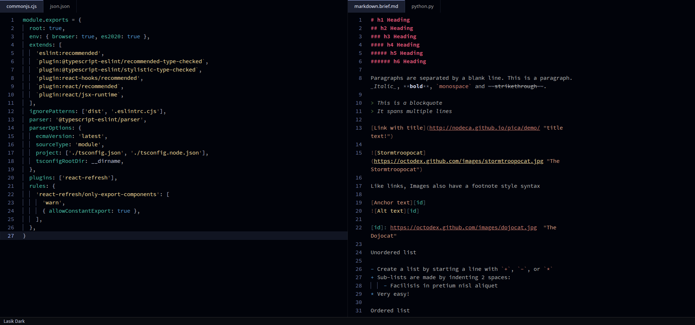
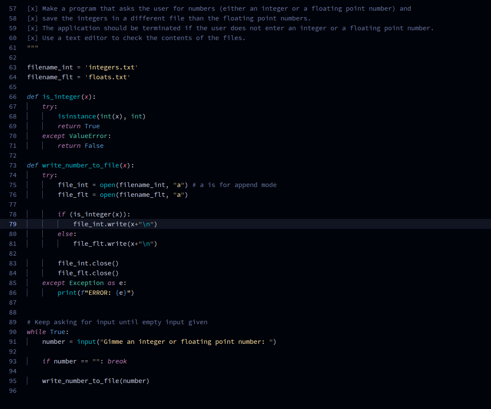
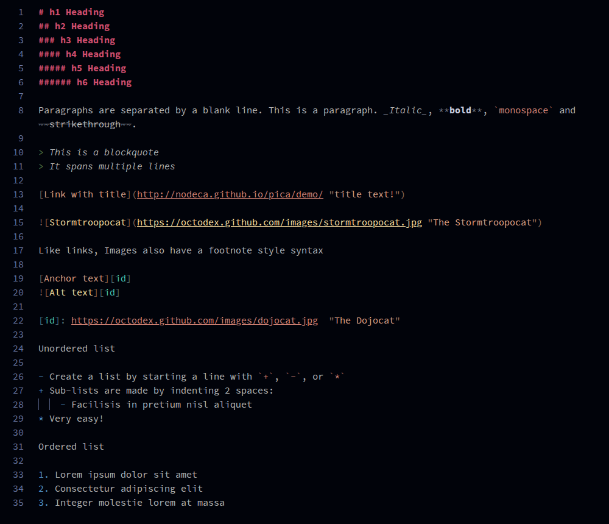
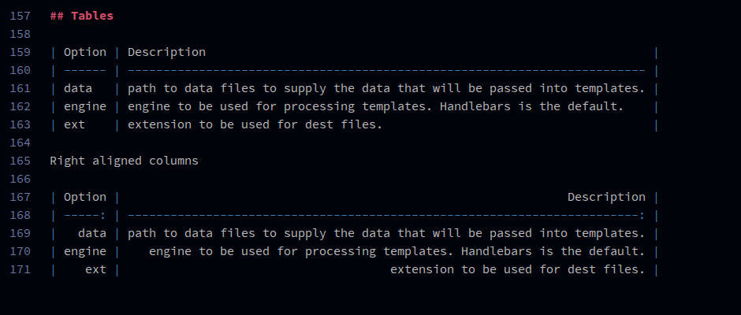
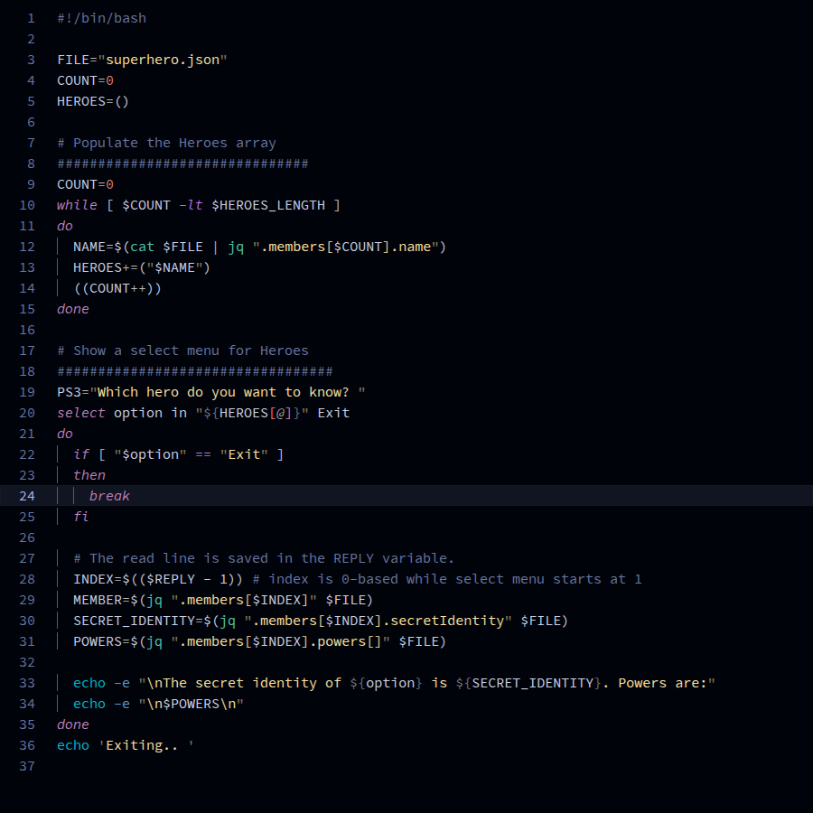
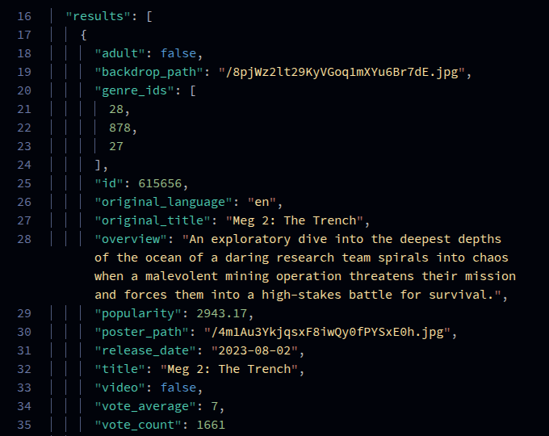
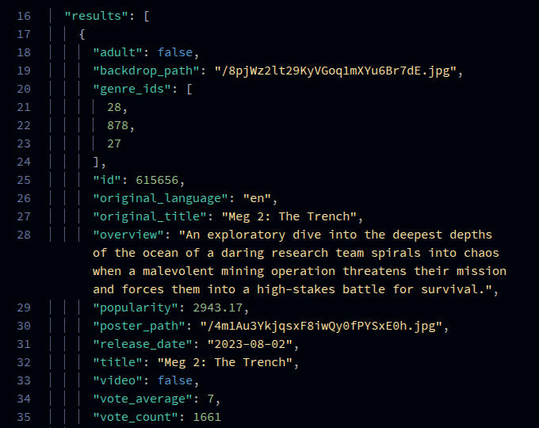

# Lasik

A dark, easy on the eyes theme for Visual Studio Code, made for sensitive eyes and long reading sessions, with good contrast. Every color comes from the [Lasik palette](https://github.com/LasikTheme/palette).

The theme was developed for personal use by a developer who writes a lot of React, TypeScript, Python, Sass/CSS, HTML and Markdown files.

## Variants

| Theme | For |
|---|---|
| **Lasik Dark** | The default. All text meets WCAG AA (4.5:1). |
| **Lasik Dark Quiet** | Punctuation, line numbers and quotes even dimmer. Opt-in: these go below WCAG on purpose, for people who find them noisy. |
| **Lasik Dark High Contrast** | Black background and code colors at 7:1 or more (WCAG AAA). |

See other Lasik ports

- [Konsole](https://github.com/LasikTheme/konsole)
- [Kitty](https://github.com/LasikTheme/kitty)
- [Claude Code](https://github.com/LasikTheme/claude-code)

**Installation**

Launch VS Code Quick Open (`Ctrl+P`), paste the following command, and press enter.

```
ext install AmnaAkram.lasik
```

Activate the theme: _Code > Preferences > Color Theme > **Lasik Dark**_ (or one of the other variants)



## Python

Docstrings use the comment color, control keywords and parameters are italic, built-ins are teal, and quotes are dimmed.



## Markdown

Markup punctuation (`#`, `**`, `_`, `` ` ``, `[ ]`, `>`) is dimmed in the color of what it wraps, and table pipes and dashes step back so the cell text is what you read.





## Bash

Attention was paid to making arithmetic evaluation, command evaluation, variables inside strings, and command names more obvious.



## Dimmed punctuation

Some elements have been dimmed (for example quotes around strings and property names in JSON and HTML, or punctuation around Markdown elements), to give more emphasis to the actual _keys_ and _values_ and not punctuation marks. The assumption here is that you already have a linter or syntax highlighting good enough to point out a missing punctuation and you don't necessarily need to see them prominently.

This is more readable:



than this:




## Built-in language support

The theme comes with syntax highlighting for these file types, so you don't need a separate extension for them:

| Language | Files |
|---|---|
| `.env` (dotenv) | `.env`, `.env.local`, `.env.production`, `.env.example`, `.flaskenv` and other `.env.*` files |
| TOML | `.toml`, `Cargo.lock`, `Pipfile`, `poetry.lock`, `uv.lock` |
| Assembly (x86 NASM) | `.asm`, `.nasm` |
| CSV and TSV, rainbow columns | `.csv`, `.tsv`, `.tab` (each column gets its own color) |
| systemd unit files (INI) | `.service`, `.socket`, `.timer`, `.target`, `.mount`, `.path`, `.network` and others |

If you use Even Better TOML, turn it off to get the Lasik TOML colors (muted quotes). YAML and Makefile highlighting are built into VS Code; the theme only sets their colors.
